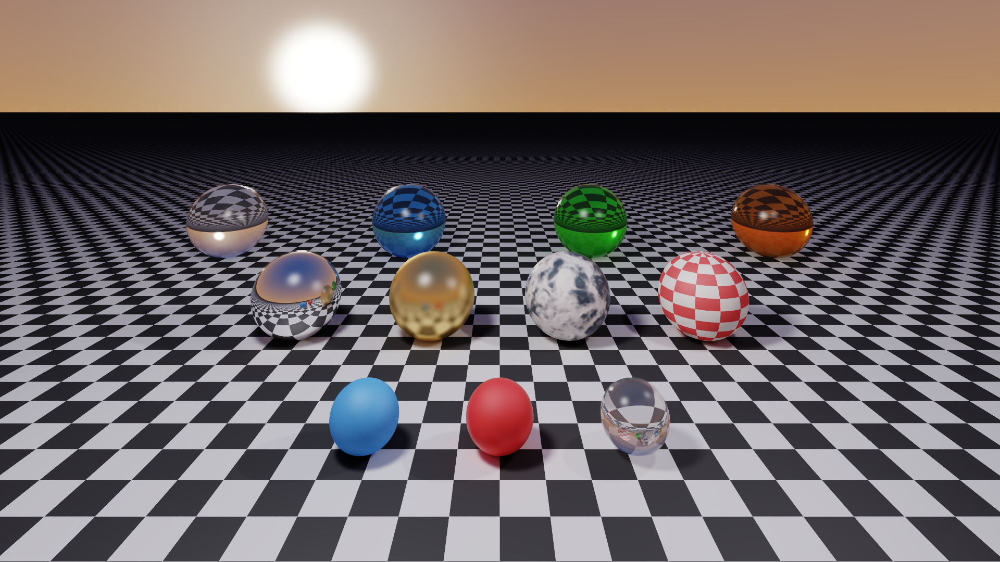
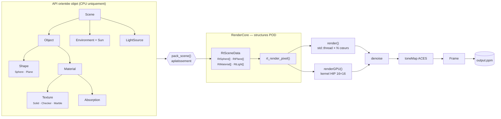

<div align="center">

# ✦ Diaphane

**Un moteur de *path tracing* écrit de zéro en C++23, exécutable sur CPU multi-thread ou sur GPU via HIP.**




<sub><i>Scène vitrine — 1920×1080, 128 échantillons par pixel, environ 13 s sur GPU (RX 7900xtx, gfx1100). Scène définie dans <code>test/test.cpp</code>.</i></sub>

</div>

---

## Sommaire

- [Présentation](#présentation)
- [Fonctionnalités](#fonctionnalités)
- [Démarrage rapide](#démarrage-rapide)
- [Compilation](#compilation)
- [Décrire une scène](#décrire-une-scène)
- [Référence de l'API](#référence-de-lapi)
- [Architecture](#architecture)
- [Le pipeline de rendu en détail](#le-pipeline-de-rendu-en-détail)
- [Structure du projet](#structure-du-projet)
- [Limites connues](#limites-connues)
- [Pistes d'évolution](#pistes-dévolution)

---

## Présentation

Ce projet implémente un moteur de rendu physique **sans aucune bibliothèque externe** : pas de GLM, pas d'Embree, pas de bibliothèque d'image. Tout, des vecteurs 3D au débruitage, est écrit à la main.

Le principe est celui du lancer de rayons inversé : plutôt que de suivre les photons depuis les lumières, on part de la caméra, on lance un rayon à travers chaque pixel, et on calcule récursivement ce qu'il rencontre — surfaces diffuses, miroirs, verre — jusqu'au ciel ou à l'épuisement de sa contribution.

Le même cœur de rendu (`RenderCore.cpp`) est compilé **deux fois** : en C++ standard pour le CPU, et en kernel HIP pour le GPU. Les deux chemins produisent donc la même image, au bruit Monte-Carlo près.

---

## Fonctionnalités

<table>
<tr>
<td width="50%" valign="top">

### 🎯 Géométrie
- **Sphères** — intersection analytique (équation quadratique)
- **Plans infinis** — équation cartésienne $ax + by + cz + d = 0$
- Coordonnées UV sphériques et planaires pour le texturage

### 🎨 Matériaux
- **Mat** (diffus lambertien + spéculaire Blinn-Phong)
- **Miroir** avec rugosité (réflexions floues)
- **Verre** avec réfraction de Snell-Descartes, réflexion totale interne et **coefficients de Fresnel** (approximation de Schlick)
- **Absorption volumique** de Beer-Lambert pour les verres teintés (saphir, émeraude, ambre)
- **Bump mapping** procédural

</td>
<td width="50%" valign="top">

### 💡 Lumière & environnement
- **Lumières sphériques** → ombres douces par échantillonnage aléatoire
- **Ombres colorées / atténuées** à travers les objets transparents
- **Ciel en dégradé** horizon → zénith avec disque solaire et halo
- 4 ambiances prédéfinies : `Summer`, `Arctic`, `Sunset`, `Cloudy`

### ⚙️ Moteur
- **Path tracing** Monte-Carlo avec rebonds diffus indirects
- **Roulette russe** pour couper les chemins peu contributifs
- **Anti-aliasing** par jitter sub-pixel
- **Débruitage** bilatéral guidé par G-Buffer (normales + albédo)
- **Tone mapping ACES** filmique
- Rendu **CPU multi-thread** ou **GPU HIP** (AMD & NVIDIA)

</td>
</tr>
</table>

### Textures procédurales

| Texture | Description | Paramètres |
|---|---|---|
| `SolidColor` | Couleur unie | `color` |
| `CheckerTexture` | Damier, avec atténuation optionnelle selon la distance | `even`, `odd`, `scale`, `distance_fade` |
| `MarbleTexture` | Marbre veiné par bruit de Perlin 3D et turbulence fractale (5 octaves) | `color1`, `color2`, `scale`, `turbulence_strength` |

---

## Démarrage rapide

```bash
# 0. Récupérer le projet
git clone https://github.com/Echeance/Diaphane.git
cd Diaphane

# 1. Compiler (détection automatique CPU / GPU)
make

# 2. Lancer le rendu — l'image est écrite dans ./output.ppm
./out/gpu/raytracer      # si compilé en mode GPU
./out/cpu/raytracer      # si compilé en mode CPU

# 3. (Optionnel) Convertir en PNG
magick output.ppm output.png
```

> [!TIP]
> La plupart des visionneuses Linux (`eog`, `feh`, GIMP…) ouvrent directement les fichiers `.ppm`. La conversion en PNG divise la taille par ~30 (le PPM P3 est un format texte : ~23 Mo en 1080p).

---

## Compilation

### Prérequis

| Composant | Version | Requis pour |
|---|---|---|
| `g++` | avec support **C++23** (GCC ≥ 13 recommandé) | toujours |
| `make` | GNU Make | toujours |
| ROCm / `hipcc` | ROCm 6.x | mode GPU (AMD) |
| CUDA Toolkit + HIP | — | mode GPU (NVIDIA) |

### Cibles du `makefile`

| Commande | Effet |
|---|---|
| `make` | Détecte automatiquement le mode : **GPU** si `hipcc` est présent *et* qu'une architecture GPU est trouvée, sinon **CPU** |
| `make cpu` | Force la compilation CPU → `out/cpu/raytracer` |
| `make gpu` | Force la compilation GPU → `out/gpu/raytracer` |
| `make clean` | Supprime `out/` et `output.ppm` |
| `make rebuild` | `clean` puis `all` |

### Détection du GPU

Le `makefile` interroge successivement `hipconfig --platform`, puis :

- **AMD** : `offload-arch` (repli sur `rocminfo`), en ignorant l'agent CPU `gfx000` ;
- **NVIDIA** : `nvidia-smi` pour récupérer la *compute capability* (`sm_XX`).

Tout peut être forcé depuis la ligne de commande :

```bash
make gpu GPU_ARCH=gfx1100            # RDNA 3 (RX 7900…)
make gpu GPU_ARCH=gfx1030            # RDNA 2 (RX 6800…)
make gpu HIP_PLATFORM=nvidia GPU_ARCH=sm_86
```

### Options de compilation

```make
-std=c++23 -Wall -Wextra -O3 -Isrc -MMD -MP
```

Les fichiers objets des deux modes sont séparés (`out/cpu/`, `out/gpu/`) : on peut basculer de l'un à l'autre sans tout recompiler. Les dépendances vers les en-têtes sont suivies automatiquement grâce à `-MMD -MP`.

---

## Décrire une scène

Les scènes sont décrites en C++, dans `test/test.cpp`. La scène fournie est une **vitrine** : chaque objet illustre une fonctionnalité du moteur.

| Zone | Objets | Fonctionnalités illustrées |
|---|---|---|
| **Fond** (z = 8) | verre clair, saphir, émeraude, ambre | réfraction, Fresnel, réflexion totale interne, absorption de Beer-Lambert |
| **Milieu** (z = 3) | miroir net, miroir doré rugueux, marbre, sphère en damier | réflexions nettes et floues, bruit de Perlin, bump mapping, UV sphériques |
| **Devant** (z = 0) | bleu mat, rouge mat rugueux, diamant | diffus lambertien, reflets de Fresnel en bord de sphère, indice de réfraction élevé (2.42) |
| **Sol** | damier | texture planaire, atténuation selon la distance |
| **Lumières** | une sphérique, une ponctuelle | ombres douces et ombres dures, ombres atténuées par le verre |
| **Ciel** | ambiance personnalisée | dégradé horizon → zénith, disque solaire et halo |

Extraits commentés :

```cpp
// ── Caméra : viewport éloigné (champ serré) et décalé vers le bas ─────
const double vp_h = 2.0, vp_w = vp_h * double(W) / H, vp_dist = 1.8;

Vector3D pov(0.0, 3.0, -6.0);                                   // position de l'œil
Vector3D center = pov + Vector3D(0.0, -0.6, vp_dist);           // centre du viewport
Vector3D vech(vp_w, 0, 0), vecy(0, vp_h, 0);                    // axes de l'écran
Viewport viewport(center - vech / 2.0 - vecy / 2.0, vech, vecy);

// ── Ciel sur mesure : soleil bas, visible devant la caméra ───────────
Environment sunset(Color{255, 150, 85}, Color{40, 60, 125},
                   Sun(Vector3D(-0.35, 0.08, 1.0), Color{255, 235, 200}, 1.2));

Scene scene(pov, viewport, sunset, 6);                          // 6 rebonds max

// ── Sol en damier à y = -1 ────────────────────────────────────────────
scene.addObject(std::make_shared<Floor>(Vector3D(), -1.0));

// ── Verres teintés : indice 1.5 + absorption volumique ───────────────
addBall(scene, Vector3D(-2.5, 0.0, 8.0), 1.0, Material::Glass(1.5, Absorption::Saphire()));

// ── Miroir doré rugueux : réflexions floues ──────────────────────────
addBall(scene, Vector3D(-1.2, -0.25, 3.0), 0.75,
        Material::Mirror(Color{255, 200, 110}, 0.85, /*roughness*/ 0.25));

// ── Marbre procédural avec bump mapping ──────────────────────────────
auto marble = std::make_shared<MarbleTexture>(Color{245, 240, 235}, Color{35, 45, 55}, 2.5, 6.0);
addBall(scene, Vector3D(1.2, -0.25, 3.0), 0.75,
        Material::Matte(marble, /*roughness*/ 0.08, /*bump*/ 0.02));

// ── Damier plaqué sur une sphère ─────────────────────────────────────
auto checker = std::make_shared<CheckerTexture>(Color{230, 60, 60}, Color{250, 245, 235}, 12.0, false);
addBall(scene, Vector3D(3.6, -0.25, 3.0), 0.75, Material::Matte(checker));

// ── Diamant ──────────────────────────────────────────────────────────
addBall(scene, Vector3D(1.6, -0.6, 0.0), 0.4, Material::Glass(2.42));

// ── Lumières : sphérique (ombres douces) + ponctuelle (ombres dures) ─
scene.addLightSource(std::make_shared<LightSource>(Vector3D(-3, 6, -1), 0.9, 0.8));
scene.addLightSource(std::make_shared<LightSource>(Vector3D( 5, 4,  1), 0.35, 0.0));

// ── Rendu : 128 échantillons par pixel ────────────────────────────────
#ifdef USE_GPU
    Frame frame = scene.renderGPU(W, H, 128);
#else
    Frame frame = scene.render(W, H, 128);
#endif
```

`addBall()` est un petit utilitaire défini dans `test.cpp`, équivalent à `scene.addObject(std::make_shared<Ball>(pos, radius, material))`.

### Repère

Le repère est **main gauche, Y vers le haut** : `+X` à droite, `+Y` en haut, `+Z` s'éloigne de la caméra. Les couleurs sont exprimées sur l'échelle **0 – 255** (en `double`, donc sans écrêtage avant le tone mapping).

---

## Référence de l'API

### `Material` — préréglages

| Préréglage | Signature | Usage |
|---|---|---|
| `Matte` | `(Color, roughness = 0, bump = 0)` | Surface diffuse unie |
| `Matte` | `(shared_ptr<Texture>, roughness = 0, bump = 0)` | Surface diffuse texturée |
| `Mirror` | `(Color, reflectivity = 0.9, roughness = 0, bump = 0)` | Métal / miroir teinté |
| `Mirror` | `(shared_ptr<Texture>, reflectivity, roughness, bump)` | Miroir texturé |
| `Glass` | `(ior = 1.5, shared_ptr<Absorption> = None(), bump = 0)` | Verre, cristal, eau… |

Le constructeur complet expose tous les paramètres :

```cpp
Material(texture, reflectivity, transparency, refractive_index,
         specular_intensity, shininess, roughness, bump_strength, absorption);
```

| Paramètre | Plage | Rôle |
|---|---|---|
| `reflectivity` | 0 → 1 | Part de lumière réfléchie spéculairement |
| `transparency` | 0 → 1 | Part de lumière transmise (réfraction) |
| `refractive_index` | ≥ 1 | Indice de réfraction (verre ≈ 1.5, eau ≈ 1.33, diamant ≈ 2.42) |
| `specular_intensity` | ≥ 0 | Intensité du reflet Blinn-Phong |
| `shininess` | ≥ 2 | Concentration du reflet (plus élevé = plus net) |
| `roughness` | 0 → 1 | Flou des réflexions/réfractions ; adoucit aussi le spéculaire |
| `bump_strength` | ≥ 0 | Amplitude de la perturbation des normales |

### `Absorption` — verres teintés

Coefficients d'atténuation par canal $(\sigma_r, \sigma_g, \sigma_b)$ : plus une valeur est élevée, plus ce canal est absorbé lors de la traversée.

| Préréglage | $\sigma_r$ | $\sigma_g$ | $\sigma_b$ | Teinte résultante |
|---|---|---|---|---|
| `None()` | 0.0 | 0.0 | 0.0 | Incolore |
| `Saphire()` | 1.2 | 0.4 | 0.05 | Bleu |
| `Emerald()` | 1.5 | 0.1 | 1.5 | Vert |
| `Amber()` | 0.1 | 0.6 | 2.0 | Orangé |

### `Environment` — ambiances

| Préréglage | Horizon | Zénith |
|---|---|---|
| `Summer()` *(défaut)* | bleu très pâle | bleu franc |
| `Arctic()` | blanc bleuté | bleu glacier |
| `Sunset()` | orange | bleu nuit |
| `Cloudy()` | gris clair | gris ardoise |

Un constructeur personnalisé est disponible : `Environment(horizon, zenith, Sun(direction, color, intensity))`.

### `Scene`

| Méthode | Description |
|---|---|
| `Scene(pov, viewport, environment = Summer(), reflection_depth = 5)` | `reflection_depth` = profondeur maximale de rebond |
| `addObject(shared_ptr<Object>)` | Ajoute une `Ball`, un `Floor` ou tout `Object` |
| `addLightSource(shared_ptr<LightSource>)` | `LightSource(pos, intensity = 1, radius = 0)` — `radius > 0` donne des ombres douces |
| `render(w, h, spp = 16)` | Rendu CPU multi-thread |
| `renderGPU(w, h, spp = 128)` | Rendu GPU (disponible uniquement si compilé avec `USE_GPU`) |

---

## Architecture

Le moteur est organisé en **deux couches** : une API orientée objet confortable pour décrire les scènes, et un cœur de rendu en structures plates, compatible GPU.



### Pourquoi deux couches ?

Le code GPU ne peut ni suivre de pointeurs vers la mémoire CPU, ni appeler de fonctions virtuelles construites côté hôte, ni utiliser `std::shared_ptr`. `Scene::pack_scene()` traduit donc la hiérarchie d'objets en **tableaux contigus de structures POD** (`RtSphere`, `RtPlane`, `RtMaterial`…), où les polymorphismes sont remplacés par des identifiants entiers (`texture_type`, `material_id`).

Toutes les fonctions de `RenderCore` sont annotées avec la macro `RT_FUNC` :

```cpp
#ifdef __HIPCC__
    #define RT_FUNC __host__ __device__   // ou __device__ seul dans GpuScene.hip
#else
    #define RT_FUNC                       // C++ standard
#endif
```

`GpuScene.hip` fait un `#include "RenderCore.cpp"` : **une seule source de vérité** pour l'algorithme, compilée par `g++` côté CPU et par `hipcc` côté GPU. Le générateur aléatoire (PCG hash) est lui aussi identique sur les deux cibles.

---

## Le pipeline de rendu en détail

### 1. Rayons primaires & anti-aliasing

Pour chaque pixel $(x, y)$ et chacun des `spp` échantillons, un décalage aléatoire $\xi \in [0, 1)^2$ est ajouté avant la projection sur le viewport :

$$
u = \frac{x + \xi_1}{W - 1}, \qquad v = \frac{H - 1 - (y + \xi_2)}{H - 1}, \qquad \vec{d} = \operatorname{normalize}\big(O + u\,\vec{h} + v\,\vec{v} - P_{\text{cam}}\big)
$$

### 2. Intersections

- **Sphère** — on résout $\lVert O + t\vec{d} - C \rVert^2 = r^2$, une équation du second degré en $t$. On garde la plus petite racine supérieure à $\varepsilon = 10^{-3}$ (ce qui évite l'auto-intersection, l'*acné*).
- **Plan** — $t = -\dfrac{\vec{n} \cdot O + d}{\vec{n} \cdot \vec{d}}$, rejeté si $|\vec{n} \cdot \vec{d}| < 10^{-6}$ (rayon parallèle).

### 3. Bump mapping

Si `bump_strength ≠ 0`, le gradient du champ de hauteur de la texture est estimé par **différences finies centrées** sur les trois axes, puis soustrait de la normale géométrique :

$$
\vec{n}' = \operatorname{normalize}\big(\vec{n} - k \cdot \nabla h(P)\big)
$$

### 4. Éclairage direct

Pour chaque lumière, un point est tiré aléatoirement dans sa sphère (→ pénombre naturelle), puis un **rayon d'ombre** est lancé. Un objet opaque bloque la lumière ; un objet transparent l'atténue d'un facteur `transparency / refractive_index`.

$$
L_{\text{diffus}} = \text{albédo} \cdot \min\Big(1, \sum_\ell I_\ell \, \max(0, \vec{n} \cdot \vec{l}) \cdot \text{att}_\ell\Big)
\qquad
L_{\text{spéc}} = \sum_\ell k_s \, I_\ell \, \max(0, \vec{n} \cdot \vec{h})^{\,s(1 - \text{roughness})} \cdot \text{att}_\ell
$$

où $\vec{h}$ est le vecteur médian (Blinn-Phong) entre la direction de la lumière et celle de l'observateur.

### 5. Rebonds secondaires

Le tracé est **itératif** (pile explicite de 6 tâches) plutôt que récursif, ce qui est indispensable sur GPU où la pile d'appels est très limitée. À chaque impact, selon le matériau, on empile :

| Type de rayon | Quand | Direction |
|---|---|---|
| **Diffus** | matériau non totalement réfléchissant/transparent | hémisphère autour de $\vec{n}$ (distribution en cosinus) |
| **Réfléchi** | `reflectivity > 0`, verre, ou surface rugueuse | $\vec{r} = \vec{d} - 2(\vec{d} \cdot \vec{n})\vec{n}$, perturbé par `roughness` |
| **Réfracté** | `transparency > 0` et pas de réflexion totale | loi de Snell-Descartes, $n_1 \sin\theta_1 = n_2 \sin\theta_2$ |

Pour le verre, la répartition réflexion / réfraction suit l'approximation de **Schlick** :

$$
R(\theta) = R_0 + (1 - R_0)(1 - \cos\theta)^5, \qquad R_0 = \left(\frac{n_1 - n_2}{n_1 + n_2}\right)^2
$$

À la sortie d'un objet transparent, la loi de **Beer-Lambert** atténue chaque canal selon la distance parcourue $t$ dans le milieu :

$$
w_c \leftarrow w_c \cdot e^{-\sigma_c \, t}
$$

Au-delà des deux premiers rebonds, la **roulette russe** interrompt aléatoirement les rayons diffus (probabilité de survie liée à l'albédo, bornée entre 0.35 et 0.95) et compense le poids des survivants pour rester non biaisé.

### 6. G-Buffer

En parallèle du tracé, chaque pixel enregistre la **normale** et l'**albédo** de la première surface non spéculaire rencontrée. Pour les miroirs et le verre lisses, on suit le rayon à travers eux (jusqu'à 4 rebonds) : le G-Buffer décrit ainsi ce qu'on *voit* dans le reflet, et le débruitage préserve les détails réfléchis.

### 7. Débruitage

Un **filtre bilatéral croisé** de rayon 3 (fenêtre 7×7) moyenne chaque pixel avec ses voisins, pondérés par :

| Poids | Formule | σ |
|---|---|---|
| Spatial | $e^{-\lVert\Delta p\rVert^2 / 2\sigma^2}$ | 2.0 |
| Normale | $e^{-\lVert\Delta \vec{n}\rVert^2 / 2\sigma^2}$ | 0.35 |
| Albédo | $e^{-\lVert\Delta a\rVert^2 / 2\sigma^2}$ | 25.0 |

Les arêtes géométriques (changement de normale) et les frontières de texture (changement d'albédo) sont ainsi conservées, tandis que le bruit Monte-Carlo dans les zones homogènes est lissé. Les pixels de ciel ne sont pas filtrés.

### 8. Tone mapping & export

La radiance HDR est multipliée par une exposition de 0.75, puis compressée par la courbe filmique **ACES** :

$$
f(x) = \operatorname{clamp}\left(\frac{x(2.51x + 0.03)}{x(2.43x + 0.59) + 0.14},\ 0,\ 1\right)
$$

L'image est enfin écrite au format **PPM P3** (texte brut, aucune dépendance).

---

## Structure du projet

```
Diaphane/
├── makefile                     Build CPU/GPU avec détection automatique
├── docs/
│   └── render.png               Rendu de la scène vitrine (illustration du README)
├── test/
│   └── test.cpp                 Point d'entrée : description de la scène + export PPM
└── src/
    ├── Color/
    │   ├── Color.{hpp,cpp}          Couleur RVB double précision, tone mapping ACES
    │   └── Absorption.{hpp,cpp}     Coefficients de Beer-Lambert + préréglages
    ├── Frame/
    │   └── Frame.{hpp,cpp}          Tampon de pixels de l'image finale
    ├── Lightning/
    │   ├── Ray.{hpp,cpp}            Rayon P(t) = O + t·d
    │   └── LightSource.{hpp,cpp}    Lumière ponctuelle ou sphérique
    ├── Maths/
    │   ├── Vector.{hpp,cpp}         Vecteur 3D (produits scalaire / vectoriel…)
    │   └── Random.{hpp,cpp}         Générateur aléatoire thread-local
    ├── Objects/
    │   ├── Object.{hpp,cpp}         Objet = centre + forme + matériau
    │   ├── Ball.{hpp,cpp}           Raccourci : objet sphérique
    │   └── Attributes/
    │       ├── Material.{hpp,cpp}   Propriétés optiques + préréglages
    │       ├── Shapes/              Shape (abstraite) · Sphere · Plane
    │       └── Textures/            Texture (abstraite) · SolidColor · Checker · Marble
    └── Scene/
        ├── Scene.{hpp,cpp}          Assemblage, packing, rendu CPU/GPU, débruitage
        ├── RenderCore.{hpp,cpp}     ★ Cœur du path tracer, partagé CPU/GPU
        ├── GpuScene.hip             Kernel HIP + transferts mémoire hôte ↔ GPU
        ├── Environment.{hpp,cpp}    Ciel + préréglages d'ambiance
        ├── Sun.{hpp,cpp}            Soleil (direction, couleur, intensité)
        └── Floor.{hpp,cpp}          Raccourci : plan horizontal en damier
```

---

## Limites connues

> [!WARNING]
> Ces points sont des comportements actuels du moteur, à garder en tête lors de la conception d'une scène.

- **Une seule table de permutation Perlin** est envoyée au rendu : si plusieurs `MarbleTexture` sont présentes, toutes utilisent la permutation de la dernière.
- **Pile de rayons bornée à 6** : avec beaucoup de verre et une profondeur élevée, des branches peuvent être silencieusement abandonnées.
- **L'atténuation du damier** (`distance_fade`) est calculée depuis l'origine du monde, pas depuis la caméra.
- **Seules les sphères et les plans** sont transmis au moteur ; une nouvelle `Shape` doit aussi être ajoutée à `pack_scene()` et à `RenderCore`.
- **Le débruitage s'exécute sur un seul thread CPU**, y compris en mode GPU.
- **Les scènes sont compilées en dur** dans `test/test.cpp` : chaque modification demande une recompilation.
- **Le chemin de sortie** (`output.ppm`) et la résolution ne sont pas paramétrables en ligne de commande.

---

## Pistes d'évolution

- [ ] Nouvelles primitives : triangles (Möller–Trumbore), maillages `.obj`, boîtes, cylindres
- [ ] Structure d'accélération (BVH) pour les scènes à nombreux objets
- [ ] Format de scène externe (JSON / YAML) et arguments en ligne de commande
- [ ] Caméra paramétrique (`look_at`, champ de vision, profondeur de champ)
- [ ] Export PNG natif et rendu progressif
- [ ] Matériaux émissifs et éclairage par environnement HDR
- [ ] Débruitage parallélisé (ou exécuté sur GPU)

---

<div align="center">
<sub>Écrit en C++ avec ☕, de l'algèbre linéaire et beaucoup de rayons.</sub>
</div>
